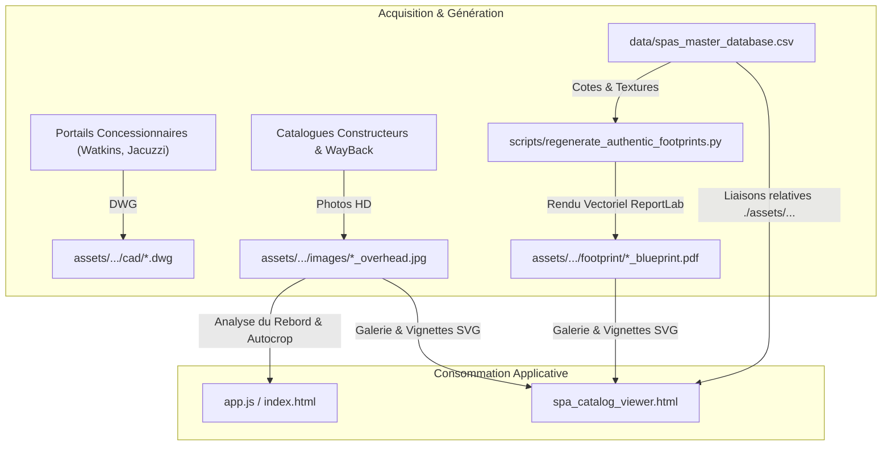

# Audit Technique Sous-Projet : Référentiel d'Actifs Graphiques, Photos & CAO (`assets/`)

> **Rôle dans l'écosystème** : Répertoire physique centralisé hébergeant l'intégralité des médias graphiques et techniques du projet : photographies réelles zénithales (Top-View / Overhead) et de profil (Side-View), plans d'implantation vectoriels (Blueprints PDF ReportLab), fichiers sources CAO (AutoCAD DWG) et répertoires réservés aux modèles 3D.
> **Date de l'audit** : 7 novembre 2026  
> **Auteur** : Lead Technical Auditor & Software Architect (Antigravity 2.0)  
> **Méthode d'audit** : Rapprochement d'intégrité binaire par script Python dédié, comparaison croisée des chemins du CSV maître avec l'arborescence physique, calcul des volumes réels et traçage des répertoires orphelins.

---

## 1. Vue Explosée de l'Existant (Architecture & Réalisations)

### Arborescence et Rôle des Fichiers

Le stockage physique des actifs suit une structure hiérarchique stricte à 3 niveaux :
`assets/<Marque>/<Modele_Vintage_Chassis>/<Sous_Dossier>/`

```
assets/
├── [90 Dossiers de Marques] (ex. Artesian Spas, Hot Spring Spas, Jacuzzi, Master Spas...)
│   └── [1 081 Dossiers de Modèles & Millésimes]
│       ├── images/      # Photos réelles haute définition (JPG, PNG, WEBP)
│       │   ├── [Modele]_overhead.jpg / .png     # Vue zénithale d'origine constructeur
│       │   ├── top_view.jpg / .png              # Vue de dessus normalisée
│       │   └── [Modele]_side.jpg                # Vue de profil de l'habillage extérieur
│       ├── footprint/   # Plans d'implantation vectoriels d'ingénierie certifiés
│       │   └── [Modele]_blueprint.pdf           # Plan vectoriel officiel SpaFit (ReportLab, US Letter)
│       ├── cad/         # Fichiers CAO d'ingénierie 2D/3D natifs
│       │   └── [Modele]_[Annee].dwg             # Fichiers binaires Autodesk AutoCAD
│       └── 3d/          # [Réservé] Répertoires pour maillages volumiques (STEP, STL, BIM)
```

#### Rôle et Caractéristiques des Types d'Actifs :

1. **`footprint/*_blueprint.pdf`** :
   - *Format* : PDF vectoriel US Letter ($612 \times 792$ pt), 300 DPI, généré par `scripts/regenerate_authentic_footprints.py`.
   - *Composition technique* : Cadre technique bleu nuit (`#0B132B`), grille cartésienne 10 mm (`#1C2541`), cartouche d'ingénierie officiel SpaFit, cotes métriques et impériales ($L, W, H, R$), réticule de centrage et incrustation de la photo zénithale réelle si disponible.
2. **`images/*_overhead.*` & `images/top_view.*`** :
   - *Formats* : JPEG, PNG 24-bit, WebP transparent.
   - *Rôle* : Fournir la texture réelle du rebord acrylique pour l'outil de traçage de joint (`app.js`) et la galerie du visualiseur (`spa_catalog_viewer.html`).
3. **`cad/*.dwg`** :
   - *Format* : AutoCAD Drawing binaire (versions R2000 à R2018).
   - *Rôle* : Plans de moules industriels d'origine constructeur (Watkins / Hot Spring, Caldera) définissant le profil exact de la lèvre d'acrylique et la courbure des coins.
4. **`3d/`** :
   - *Statut* : Répertoires réservés pré-créés lors des vagues d'ingestion.

---

### Flux de Données (Pipeline des Actifs)



---

### Métriques Réelles (Constatées Physiquement sur Disque)

| Métrique Physique | Valeur Réelle sur Disque | Commentaire d'Ingénierie |
| :--- | :--- | :--- |
| **Volume total sur disque de `assets/`** | **2,42 Go** (2 475,19 Mo) | Poids dominé par les photos HD et les 1 008 PDF haute résolution |
| **Nombre total de fichiers stockés** | **2 010** fichiers | Répartis sur l'ensemble des 90 marques |
| **Dossiers de marques physiques** | **90** marques | Dont deux dossiers pour Catalina (`Catalina` et `Catalina Spas`) |
| **Dossiers de modèles physiques** | **1 081** dossiers | Dont 972 reliés à `spas_master_database.csv` et 109 non reliés |
| **Plans d'implantation PDF (`footprint/`)** | **1 008** fichiers physiques | 1 036 fiches liées dans le CSV maître |
| **Photos dans `images/`** | **942** fichiers | 424 PNG, 406 JPG, 112 WEBP |
| **Fichiers CAO DWG (`cad/`)** | **59** fichiers physiques | 47 fichiers uniques reliés à 62 fiches dans le CSV |
| **Fichiers 3D (`3d/`)** | **0** fichier (0 Ko) | 514 sous-dossiers `3d/` créés mais totalement vides |
| **Actifs orphelins sur disque** | **158** fichiers (**180,60 Mo**) | 57 JPG, 52 PNG, 34 PDF, 12 DWG dans les 109 dossiers non indexés |

---

## 2. Historique des Défis, Essais-Erreurs & Solutions (Code + Conversation)

### Chronologie des Problèmes Rencontrés en Session :

1. **La Crise des Faux Dessins Pillow (>14 300 Fichiers Synthétiques)** :
   - *Historique* : Lors des premiers développements de l'écosystème, l'ancien script `scrapping python/_archive_legacy/asset_generator.py` avait automatisé la synthèse de faux schémas 2D (`footprint.png`, `top_view.png`) pour donner l'illusion d'une base couverte à 100 %.
   - *Impact constaté* : Ces fichiers synthétiques occupaient des centaines de mégaoctets et trompaient l'algorithme de détection de rebord de `app.js`.
   - *Solution mise en place* : Suppression complète de tous les fichiers synthétiques, mise en quarantaine de l'ancien générateur et remplacement systématique par les plans vectoriels ReportLab certifiés (`_blueprint.pdf`).
2. **Collision et Déduplication par Hachage Binaire MD5** :
   - *Historique* : Lors des vagues d'ingestion successives (`apply_wave*.py`), des photos d'un modèle phare (ex. Hot Spring Aria ou Vanguard) ont été copiées dans les dossiers d'autres modèles ou de millésimes différents.
   - *Solution implémentée* : Les scripts d'audit forensique `analyze_all_duplicates_detail.py` et `execute_zero_duplicate_purge.py` ont calculé les signatures MD5 strictes et purgé les images redondantes pour ne préserver que l'image authentifiée par génération.
3. **Scission des Modèles "Parapluies" et Création d'Actifs Orphelins** :
   - *Historique* : Lors de la normalisation générationnelle, des fiches regroupant plusieurs modèles (ex. `Jacuzzi J-215 _ J-315` ou `Hot Spring Aria_AR_2007-2013`) ont été divisées en fiches unitaires dans le CSV maître.
   - *Effet secondaire imprévu* : Les dossiers physiques d'origine contenant de vraies photographies et des fichiers DWG n'ont pas été renommés ou ré-indexés dans le CSV. Ils sont devenus "orphelins", immobilisant 180,6 Mo d'actifs précieux hors du catalogue actif.
4. **Collision de Nommage de Marques (`Catalina` vs `Catalina Spas`)** :
   - *Historique* : Deux scrapers ont utilisé une graphie différente pour la même marque, créant deux dossiers distincts sur le disque : `assets/Catalina` (11 modèles) et `assets/Catalina Spas` (10 modèles), avec des dossiers redondants (`Malibu`, `Olympic 16`, `C-411`).

---

## 3. Goulots d'Étranglement Actuels (Code, Données & Exécution Agent)

### Goulots Techniques & Données :
- **158 Fichiers d'Ingénierie Orphelins (180,6 Mo)** : 57 vraies photos de dessus et 12 fichiers AutoCAD DWG d'origine dorment dans 109 dossiers physiques non indexés dans `spas_master_database.csv`.
- **Incompatibilité Directe DWG $\rightarrow$ Web** : Les 59 fichiers DWG sont au format binaire propriétaire AutoCAD R2000-R2018. Aucun navigateur web ne pouvant lire un DWG, ces fichiers restent inaccessibles dans le Canvas de `app.js` sans conversion préalable en SVG vectoriel.
- **514 Dossiers 3D Fantômes** : 514 sous-répertoires `3d/` vides encombrent l'arborescence sans apporter aucune information géométrique.
- **Taux de Couverture Photo Réelle Plafonné à 39,86 %** : 623 modèles doivent recourir à un rendu vectoriel schématique faute de photo zénithale réelle.

### Goulots de Workflow Observés lors des Actions :
- **Blocage des Commandes Récursives Globales sous Windows** : L'exécution de scans `os.walk('.')` ou de commandes PowerShell `Get-ChildItem -Recurse` sans filtrage préalable de `assets/` (2,42 Go / 2 010 fichiers) provoque des dépassements de délai d'attente (timeouts de 5 secondes) et requiert l'annulation manuelle de la tâche en arrière-plan.

---

## 4. Registre des Bogues Actifs (Par Dossier et Fichier)

| Dossier ou Fichier Concerné | Sévérité | Description Exacte du Bogue | Cause Racine, Impact & État de Correction |
| :--- | :--- | :--- | :--- |
| **`assets/Catalina`** vs **`assets/Catalina Spas`** | **Moyen** | Collision de répertoire de marque : 2 dossiers coexistent avec des modèles doublons (`Malibu`, `Olympic 16`, `C-411`). | Incohérence de nommage lors des premières vagues d'ingestion. Risque de référence morte selon la graphie utilisée dans le CSV. Non corrigé. |
| **`assets/Hot Spring Spas/Aria_AR_2007-2013/`** | **Moyen** | Fichier DWG d'origine (`Aria_2007.dwg`) et photo HD (`Aria_overhead.jpg`) orphelins non liés au CSV. | Le CSV maître a indexé `Aria_2007-2013` sans l'extension `AR`, rompant la liaison vers les fichiers existants. Non corrigé. |
| **`assets/American Whirlpool/DM8_AW-DM8_2017-2026/`** | **Moyen** | Photo vue de dessus réelle (`top_view.jpg`) présente sur disque mais non reliée au CSV maître. | Le modèle DM8 est répertorié sous une autre clé dans le CSV maître. Non corrigé. |
| **`assets/Vortex Spas/AquaGym Max Pro+/`** | **Mineur** | Caractère spécial `+` non encodé dans le nom de fichier et de dossier (`AquaGym Max Pro+_overhead.png`). | Risque d'erreur HTTP 404 (confusion espace/plus) lors du chargement par le visualiseur web sans `encodeURIComponent`. Non corrigé. |
| **514 dossiers `assets/*/*/3d/`** | **Mineur** | 514 répertoires vides présents sur disque sans aucun fichier (0 octet). | Génération de squelettes de répertoires non nettoyés post-importation. Non corrigé. |

---

## 5. Ce Qu'il Reste à Faire (Backlog Technique Priorisé)

1. [ ] **Script de Rapprochement et Sauvetage des Actifs Orphelins (Priorité 1 - Objectif 1)** :
   - Développer `scripts/reconcile_orphan_assets.py` pour analyser automatiquement les 109 dossiers non indexés, réassocier les 57 photos réelles et 12 DWG aux fiches correspondantes dans `spas_master_database.csv`.
2. [ ] **Pipeline Headless DWG $\rightarrow$ DXF $\rightarrow$ SVG (Priorité 2 - Objectif 1 & 2)** :
   - Mettre en place un utilitaire basé sur `libredwg` / `ezdxf` pour convertir les 59 fichiers DWG en tracés vectoriels SVG légers affichables directement dans le Canvas de `app.js`.
3. [ ] **Fusion et Normalisation du Dossier Marque Catalina (Priorité 3)** :
   - Déplacer les modèles de `assets/Catalina` vers `assets/Catalina Spas` et éliminer le dossier redondant.
4. [ ] **Nettoyage des 514 Répertoires 3D Fantômes (Priorité 4)** :
   - Supprimer les dossiers `3d/` vides jusqu'à ce que de véritables modèles STEP/STL soient collectés.
5. [ ] **Sanitisation des Noms de Fichiers (Priorité 5)** :
   - Remplacer les caractères `+` et espaces multiples dans les chemins d'accès par des tirets bas standardisés (`_`).

---

## 6. Dépendances Inter-Projets & Points de Friction

- **Producteurs d'Actifs** :
  - `scrapping python/` : Dépose les photos et les DWG bruts.
  - `scripts/regenerate_authentic_footprints.py` : Dépose les 1 008 PDF dans `footprint/`.
- **Consommateurs d'Actifs** :
  - `data/spas_master_database.csv` : Référence les chemins physiques via des liens relatifs (`./assets/...`).
  - `data/spas_catalog_data.js` : Propage les chemins d'accès aux applications web.
  - `spa_catalog_viewer.html` & `app.js` : Affichent les images et plans d'ingénierie.
- **Point de friction majeur** : La non-résolution des 158 fichiers orphelins prive le catalogue de photographies réelles pour 57 modèles qui doivent inutilement se rabattre sur un dessin vectoriel schématique.

---
*Fin de l'audit technique assets/*
