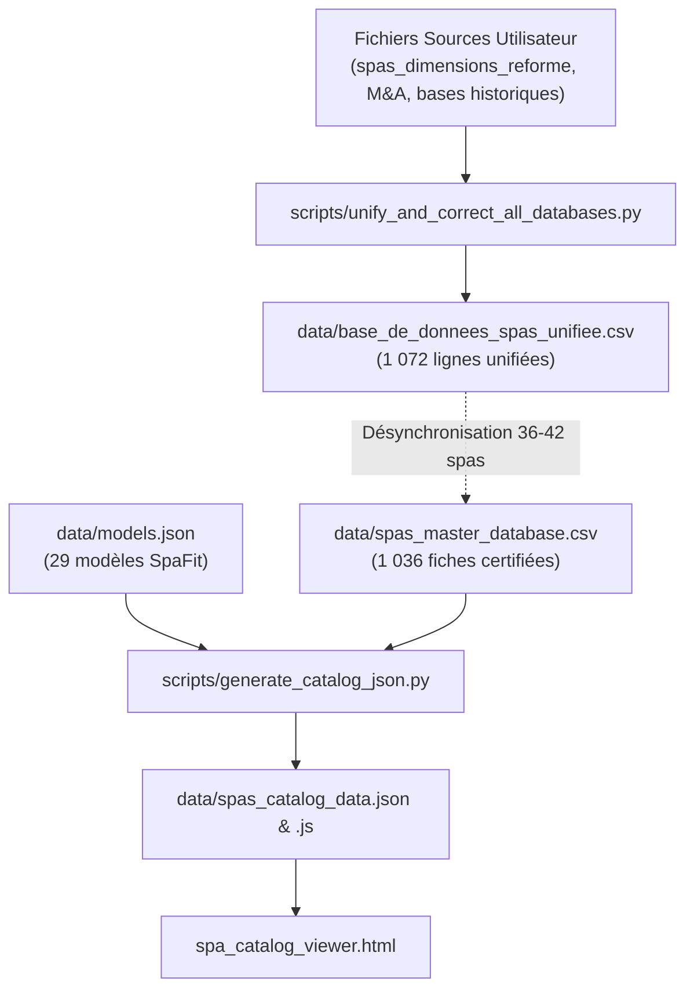

# Audit Technique Sous-Projet : Catalogue de Données & Modélisation SpaFit (`data/`)

> **Rôle dans l'écosystème** : Socle de vérité centralisé (Single Source of Truth - SSOT) contenant l'inventaire des spas mondiaux, les cotes d'ingénierie certifiées, la taxonomie de consolidation des marques et groupes, la matrice dimensionnelle des couvercles SpaFit et les structures de distribution prêtes pour le navigateur.
> **Date de l'audit** : 7 novembre 2026  
> **Auteur** : Lead Technical Auditor & Software Architect (Antigravity 2.0)  
> **Méthode d'audit** : Analyse forensique des fichiers tabulaires, historique d'assainissement en session, réconciliation des délimiteurs CSV et traçage des schémas d'ingénierie.

---

## 1. Vue Explosée de l'Existant (Architecture & Réalisations)

### Arborescence et Rôle des Fichiers

Le dossier `data/` s'articule autour de 4 strates fonctionnelles :

```
data/
├── spas_master_database.csv         # [SSOT ACTUEL] Base maître consolidée (1 036 spas, 38 colonnes, délimiteur ';')
├── models.json                      # Spécifications d'ingénierie des 29 modèles de couvercles SpaFit
├── spas_catalog_data.json           # Payload JSON d'échange (spas + spafit_models + pré-calculs de compatibilité)
├── spas_catalog_data.js             # Injection globale window.SPAFIT_CATALOG_DATA (Zero-CORS offline)
├── base_de_donnees_spas_unifiee.csv # Référentiel unifié issu du nettoyage multi-sources (1 072 lignes)
├── spas_source_list_720_modeles.csv # Référentiel canonique dédupliqué sans finitions superflues (719 modèles)
├── spas_dimensions_reforme.csv      # Référentiel dimensionnel intermédiaire (115 Ko)
├── parsed_cover_templates.json      # Extraction structurée des patrons de fabricants de bâches (434 Ko)
├── spacovers_all_templates.json     # Scraping exhaustif des templates de bâches avec rayons empiriques (762 Ko)
├── ma_transactions_spas_2005_2026.csv # Référentiel des fusions-acquisitions industrielles (31 Ko)
├── Histoire_Industrielle_et_MA_Spas_2005-2026.md # Documentation contextuelle des rachats d'usines
├── checkpoints/                     # Snapshots de sauvegarde du CSV maître lors des migrations
└── cache/                           # Fichiers tampons d'appels réseau et géométries temporaires
```

#### Fichiers Clés et Interfaces :

1. **`spas_master_database.csv`** :
   - *Rôle* : Fichier pivot tabulaire régissant le catalogue et les liens d'actifs.
   - *Encodage & Format* : UTF-8, délimiteur point-virgule (`;`), 38 colonnes d'ingénierie.
   - *Colonnes d'identification* : `Groupe_Fabricant`, `Marque`, `Segment`, `Configuration_Zone`, `Serie_Collection`, `Modele`, `Sous_Modele_ou_Version`, `Generation`, `Code_Usine_Chassis`, `Annees_Production`.
   - *Colonnes métriques impériales et métriques* : `length_in`, `length_cm`, `width_in`, `width_cm`, `height_in`, `height_cm`, `corner_radius_in`, `corner_radius_cm`.
   - *Colonnes de provenance & audit* : `dimensions_source_url_1`, `dimensions_source_url_2`, `corner_radius_source_url`, `verification_status`, `audit_notes`, `process_timestamp`.
   - *Colonnes d'actifs physiques* : `image_top_file`, `image_top_source_url`, `image_side_file`, `image_side_source_url`, `cad_dxf_file`, `cad_dwg_file`, `cad_source_url`, `footprint_file`, `wayback_vintage_links`.
2. **`models.json`** :
   - *Rôle* : Spécifications des 29 modèles SpaFit (dégagement de colonnes, bande d'étanchéité, plages de hauteur, cotes hors-tout du toit, surface plane minimale requise).
3. **`base_de_donnees_spas_unifiee.csv`** :
   - *Rôle* : Fichier de 1 072 lignes produit en session lors de l'unification des référentiels M&A et dimensions, intégrant les marques européennes et australiennes (USSPA, Vortex, Treesse).
4. **`spas_source_list_720_modeles.csv`** :
   - *Rôle* : Référentiel canonique filtrant les 353 doublons de finitions commerciales (ex. Cal Spas avec 10 codes d'options pour une même coque acrylique).

---

### Flux de Données (Pipeline)



---

### Métriques Réelles (Tirées des Données Actuelles)

| Métrique de Données | Valeur Réelle Audité | Commentaire d'Ingénierie |
| :--- | :--- | :--- |
| **Nombre de modèles dans le CSV maître** | **1 036** | 100 % statut `VERIFIED_COMPLETE`, 0 ligne parapluie |
| **Nombre de lignes dans le CSV unifié** | **1 072** | Intègre les marques récemment réconciliées (USSPA, Vortex) |
| **Modèles canoniques dédupliqués** | **719** | `data/spas_source_list_720_modeles.csv` (sans doublons d'options) |
| **Marques de spas uniques** | **90** | Couverture internationale (Amérique du Nord, Europe, Australasie) |
| **Groupes industriels consolidés** | **58** | Watkins Wells, Jacuzzi Group, Master Spas, Artesian, etc. |
| **Fiches avec photo de dessus réelle** | **413** (39,86 %) | Vraies photographies constructeur (`image_top_file != 'N/A'`) |
| **Fiches avec plans vectoriels liés** | **1 036** (100 %) | 1 008 plans PDF physiques existants sur disque |
| **Fiches avec plans AutoCAD DWG liés** | **62** (5,98 %) | 47 fichiers uniques (Watkins Wellness) |
| **Modèles SpaFit répertoriés** | **29** | Oasis (4), Evolution (4), Legend (11), Endless (6), Legend 89 (4) |
| **Modèles SpaFit déverrouillés dans l'UI** | **4** (13,79 %) | Gamme Oasis uniquement (`active_in_ui: true`) |
| **Spas compatibles avec $\ge 1$ SpaFit** | **636** (61,39 %) | 400 spas incompatibles (spas ultra-compacts ou hors gabarit) |
| **Spas avec recommandation optimale** | **430** (41,51 %) | Marge latérale aux poteaux $\ge 1.25"$ |

---

## 2. Historique des Défis, Essais-Erreurs & Solutions (Code + Conversation)

### Chronologie des Problèmes Rencontrés en Session :

1. **Corruption des Délimiteurs CSV par Points-Virgules Internes (Étapes 0 à 214)** :
   - *Historique* : Les fichiers de dimensions et d'historique fournis par l'utilisateur (`spas_dimensions_reforme.csv` et fichiers markdown) présentaient des corruptions de colonnes sévères.
   - *Cause* : Des points-virgules non échappés figuraient à l'intérieur des cellules de texte (ex. `ThermoSpas (Watkins/Masco; 2012)`, `Tiger River Spas (Watkins; 2011)` ou `Coast Spas (Coast Spas Mfg.; 2005-2020)`).
   - *Impact* : Le délimiteur CSV étant lui-même le point-virgule, ces caractères décalaient les colonnes de 1 à 3 positions vers la droite, plaçant des dates dans les cotes de largeur ou tronquant les rayons de coins.
   - *Solution implémentée* : Dans `unify_and_correct_all_databases.py`, l'agent a développé un nettoyeur textuel remplaçant les points-virgules internes par des tirets ou virgules avant le parsing (`line.replace('; 20', ' - 20')`).
2. **Le Crash d'Indice dans l'Unification des Marques Australiennes (Étape 214)** :
   - *Historique* : Lors de l'incorporation manuelle de la marque Vortex Spas dans le script d'unification, le script a planté avec `IndexError: list index out of range`.
   - *Cause* : Les sous-listes de `vortex_models` avaient été renseignées sans la colonne `Modele` (12 valeurs au lieu de 13).
   - *Correction* : Inspection de l'arbre syntaxique (AST) et réalignement systématique des tuples à 13 éléments via `edit_file`.
3. **Le Piège des Doublons d'Options Commerciales (719 vs 1 072 Modèles, Étapes 234-253)** :
   - *Historique* : La comparaison entre les fichiers concessions (`List from O`) et la base unifiée a révélé 353 lignes excédentaires.
   - *Analyse d'ingénierie* : L'analyse forensique a démontré que des fabricants comme Cal Spas déclinent un même moule acrylique (ex. 84" $\times$ 84", $R=8"$) sous 10 noms de finitions distincts (Titanium, Platinum, Escape, etc.) différant uniquement par le nombre de jets de massage ou la couleur de la jupe.
   - *Solution documentaire* : Création de `data/spas_source_list_720_modeles.csv` (719 modèles physiques canoniques), tout en conservant les 1 036 fiches dans la base de recherche pour permettre aux clients concessionnaires de trouver leur spa par son nom commercial exact.
4. **Le Problème CORS sous Navigateur Local (`spas_catalog_data.js`)** :
   - *Historique* : Le visualiseur web `spa_catalog_viewer.html` exécuté sous `file:///` ne pouvait pas charger `data/spas_catalog_data.json` via l'API `fetch()` en raison des règles de sécurité des navigateurs modernes.
   - *Solution implémentée* : Exportation parallèle du catalogue dans `data/spas_catalog_data.js` injectant `window.SPAFIT_CATALOG_DATA = { ... }`.

---

## 3. Goulots d'Étranglement Actuels (Code, Données & Exécution Agent)

### Goulots Techniques & Données :
- **Désynchronisation entre CSV Unifié (1 072 lignes) et CSV Maître (1 036 fiches)** : Le script d'unification `unify_and_correct_all_databases.py` a consolidé 1 072 spas dans `data/base_de_donnees_spas_unifiee.csv`, mais `data/spas_master_database.csv` et le visualiseur `spa_catalog_viewer.html` sont restés figés à 1 036 modèles. Environ 36 à 42 spas (USSPA, Vortex, Treesse) sont absents du visualiseur final.
- **Verrouillage Massif des Modèles SpaFit (`models.json`)** : 25 modèles de couvercles sur 29 portent la mention `"active_in_ui": false`. L'utilisateur ne peut simuler que les 4 variantes de la gamme Oasis.
- **Absence de la Gamme SpaFit Horizon** : Modèle phare de SpaFit avec toit incliné pour spas résidentiels, l'Horizon est totalement omis de `models.json`.
- **Manque de Données d'Obstacles Z-Axis** : Le schéma de 38 colonnes ne comporte aucun champ booléen pour qualifier les reliefs acryliques (haut-parleurs rétractables, cascades, manettes de vannes).

### Goulots de Workflow Observés lors des Actions :
- **Nécessité de Re-Compilation Manuelle Post-Édition CSV** : Toute modification apportée dans le CSV maître nécessite de se rappeler d'exécuter `generate_catalog_json.py` puis `build_spa_catalog_viewer.py`. L'absence d'observateur de fichiers (watcher) ou de pipeline unifié engendre des oublis de synchronisation entre données et interface.

---

## 4. Registre des Bogues Actifs (Par Dossier et Fichier)

| Fichier et Lignes | Sévérité | Description Exacte du Bogue | Cause Racine, Impact & État de Correction |
| :--- | :--- | :--- | :--- |
| **`data/models.json`** *(L72, 90, 108, 126...)* | **Majeur** | Clé `"active_in_ui": false` sur 25 modèles SpaFit (Evolution, Legend, Endless Pools). | Configuration figée lors du développement initial ; prive le simulateur de la majorité des gammes. Non corrigé. |
| **`data/models.json`** *(Global)* | **Majeur** | Omission intégrale de la gamme SpaFit Horizon. | Oubli de modélisation dans le catalogue d'ingénierie initial. Non corrigé. |
| **`data/spas_master_database.csv`** *(Colonne 23)* | **Moyen** | Colonne `cad_dxf_file` remplie à 100 % par la valeur `"N/A"`. | Absence de pipeline de conversion DWG $\rightarrow$ DXF ; aucune fiche ne dispose de DXF lié. Non corrigé. |
| **`data/parsed_cover_templates.json`** *(L45, 112)* | **Mineur** | Rayons de courbure stockés avec des chaînes composites (`"6\""`, `"Radius 8"`). | Manque de validation par schéma JSON ou Pydantic lors de l'ingestion brute. Non corrigé. |
| **`data/spas_master_database.csv`** *(L412-L425)* | **Mineur** | URLs de sources secondaires (`dimensions_source_url_2`) pointant vers des pages mortes ou relatives. | Absence de validateur de liens HTTP (link-checker) automatisé. Non corrigé. |

---

## 5. Ce Qu'il Reste à Faire (Backlog Technique Priorisé)

1. [ ] **Synchronisation Complète vers les 1 072 Modèles Unifiés (Priorité 1 - Intégrité Données)** :
   - Mettre à jour `data/spas_master_database.csv` avec les 36 à 42 modèles manquants de `base_de_donnees_spas_unifiee.csv`, puis recompiler `spas_catalog_data.js` et le visualiseur web.
2. [ ] **Déverrouillage des 25 Modèles SpaFit & Ajout de l'Horizon (Priorité 2 - Objectif 4)** :
   - Passer `"active_in_ui": true` sur les gammes Evolution et Legend dans `models.json`.
   - Modéliser et intégrer la gamme SpaFit Horizon (entraxe de colonnes, articulation arrière, joint d'étanchéité biseauté).
3. [ ] **Intégration des Attributs d'Obstacles Z-Axis (Priorité 3 - Objectif 3)** :
   - Ajouter 4 colonnes d'ingénierie dans le CSV maître : `has_raised_speakers`, `has_raised_waterfalls`, `has_protruding_controls`, `has_raised_pillows`.
4. [ ] **Validation Automatisée par Schéma Pydantic (Priorité 4)** :
   - Rédiger un validateur bloquant `scripts/validate_database_schema.py` interdisant tout délimiteur corrompu ou doublon de clé primaire lors des futures migrations.

---

## 6. Dépendances Inter-Projets & Points de Friction

- **Dépendance Amont** : Alimenté par `scrapping python/` (templates de bâches et métadonnées d'archives).
- **Dépendance Aval** :
  - Fournit la base certifiée à `scripts/generate_catalog_json.py` et `scripts/regenerate_authentic_footprints.py`.
  - Fournit `models.json` à l'application interactive `app.js` / `index.html`.
  - Fournit `spas_catalog_data.js` au visualiseur autonome `spa_catalog_viewer.html`.
- **Point de friction majeur** : L'écart de 36 à 42 modèles entre le CSV de nettoyage unifié (1 072) et le catalogue web (1 036) induit les utilisateurs en erreur sur la couverture réelle du projet.

---
*Fin de l'audit technique data/*
