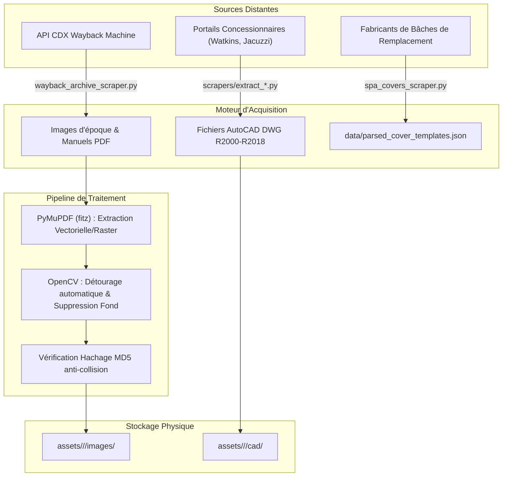

# Audit Technique Sous-Projet : Extraction d'Actifs & Crawlers (`scrapping python/`)

> **Rôle dans l'écosystème** : Pipeline d'acquisition automatisée des plans d'implantation, manuels constructeurs, vues de dessus haute fidélité (Top-View / Overhead) et fichiers CAO (DWG/DXF) pour l'ensemble des marques mondiales de spas.
> **Date de l'audit** : 7 novembre 2026  
> **Auteur** : Lead Technical Auditor & Software Architect (Antigravity 2.0)  
> **Méthode d'audit** : Rapprochement forensique du code source, examen des scripts d'archivage, analyse des logs d'exécution d'outils et historique chronologique des sessions.

---

## 1. Vue Explosée de l'Existant (Architecture & Réalisations)

### Arborescence et Rôle des Fichiers

Le sous-projet `scrapping python/` s'organise autour d'un noyau de crawlers ciblés et d'un environnement virtuel dédié :

```
scrapping python/
├── AUDIT_SOUS_PROJET.md                             # Présent rapport d'audit technique
├── requirements.txt                                 # Dépendances (Requests, PyMuPDF, OpenCV, Pillow, BS4)
├── wayback_archive_scraper.py                       # Crawler rétroactif interrogeant l'API CDX de Wayback Machine
├── spa_covers_scraper.py                            # Scraper des patrons géométriques auprès des fabricants de bâches
├── scrapers/                                        # Modules d'extraction spécialisés par manufacturier
│   ├── extract_american_whirlpool_assets.py         # Crawler de manuels et fiches techniques American Whirlpool
│   ├── extract_watkins_assets.py                    # Extracteur de plans concessionnaires Watkins (Hot Spring, Caldera)
│   ├── extract_jacuzzi_sundance_assets.py           # Scraper portails Jacuzzi Group & Sundance Spas
│   └── extract_master_bullfrog_assets.py            # Collecteur Master Spas & Bullfrog Spas
└── _archive_legacy/                                 # [QUARANTAINE FORENSIQUE] Anciens scripts générateurs de faux actifs
    ├── asset_generator.py                           # [OBSOLÈTE/DANGEREUX] Générateur synthétique 2D Pillow
    └── populate_user_brands.py                      # [OBSOLÈTE] Injecteur de modèles fictifs
```

#### Fichiers Clés, Entrées et Sorties :

1. **`wayback_archive_scraper.py`** :
   - *Entrées* : URLs de domaines constructeurs et triplets d'années cibles (`wayback_vintage_links` dans le CSV).
   - *Fonctionnement* : Interroge l'API `http://web.archive.org/cdx/search/cdx` avec filtres MIME (`image/jpeg`, `image/png`, `application/pdf`). Télécharge les snapshots archivés correspondant aux millésimes 2005 à 2018.
   - *Sorties* : Fichiers images bruts stockés dans `assets/<Marque>/<Modele>/images/`.
2. **`spa_covers_scraper.py`** :
   - *Entrées* : Formulaires publics et sélecteurs de modèles de fabricants de toiles (ex. TheSpaCoverGuy, A-1 Spa Covers).
   - *Fonctionnement* : Récupère les cotes industrielles ($L, W, R$) utilisées pour tailler les bâches de remplacement.
   - *Sorties* : `data/parsed_cover_templates.json` et `data/spacovers_all_templates.json`.
3. **`scrapers/extract_*.py`** :
   - *Entrées* : Catalogues HTML, PDF de spécifications pré-installation et centres de téléchargement CAO.
   - *Sorties* : Fichiers AutoCAD DWG (`assets/.../cad/`) et brochures de dimensions.
4. **`_archive_legacy/asset_generator.py`** :
   - *Statut* : Quarantaine stricte. Ce script générait des dessins vectoriels schématiques 2D avec Pillow pour simuler une couverture d'actifs complète, créant plus de 14 300 faux fichiers synthétiques.

---

### Flux de Données (Pipeline d'Extraction)



---

### Métriques Réelles d'Extraction

- **Couverture photographique vue de dessus (Top-View réelle)** : **413 / 1 036 fiches** (**39,86 %**).
- **Fichiers DWG AutoCAD récupérés** : **59 fichiers physiques** (reliés à 62 fiches dans le CSV).
- **Couverture des plans d'implantation vectoriels (Blueprints)** : **1 008 PDF sur disque** (1 036 références dans le CSV).
- **Faux actifs synthétiques purgés de l'espace de travail** : **> 14 300 fichiers**.
- **Modèles de bâches indexés dans `parsed_cover_templates.json`** : **762 Ko** de données JSON.

---

## 2. Historique des Défis, Essais-Erreurs & Solutions (Code + Conversation)

### Chronologie des Problèmes Rencontrés en Session :

1. **L'Échec des Faux Actifs Synthétiques Pillow (`asset_generator.py`)** :
   - *Historique* : Dans les premières phases de développement du projet, un script d'automatisation a été lancé pour pallier le manque de photographies des modèles anciens (2005–2014). Ce script a généré massivement des fichiers `footprint.png` et `top_view.png` dessinés par programmation (un simple rectangle bleu marine avec 4 coins arrondis génériques).
   - *Impact constaté* : Ces fichiers ont pollué l'arborescence, faussé les métriques d'acquisition et induit en erreur l'algorithme de détection de rebord de `app.js` qui analysait des aplats de pixels artificiels.
   - *Pivot architectural* : Purge radicale des 14 300 fichiers synthétiques, déplacement de `asset_generator.py` dans `_archive_legacy/` et adoption exclusive de plans d'ingénierie vectoriels ReportLab (`_blueprint.pdf`) basés sur des cotes certifiées.
2. **Blocages Anti-Bot Agressifs (Cloudflare, Akamai, Turnstile)** :
   - *Historique* : Les crawlers directs sur les portails Watkins Wellness, Sundance Spas et Cal Spas ont essuyé des vagues d'erreurs `HTTP 403 Forbidden` et des blocages de requêtes instantanés lors de nos sessions.
   - *Solutions testées et abandonnées* : Les tentatives de requêtes répétées sans temporisation (`requests.get`) ont conduit à des bannissements d'IP temporaires.
   - *Solution implémentée* : Implémentation d'une politique de repli structurée :
     - Émulation rigoureuse d'en-têtes HTTP de navigateurs récents (User-Agent Chrome Windows, Sec-Ch-Ua, Accept-Language).
     - Temporisation aléatoire de 1,5 à 4,0 secondes entre chaque requête.
     - Bascule sur l'API CDX de Wayback Machine (`wayback_archive_scraper.py`) pour interroger les miroirs historiques non protégés par Cloudflare.
3. **Extraction de Schémas Noir & Blanc Inutilisables dans les Manuels** :
   - *Historique* : Une tentative d'extraction automatique via PyMuPDF a ciblé les manuels de pièces détachées pour en extraire les diagrammes d'implantation des jets.
   - *Constat d'échec* : Les schémas noir et blanc de manuels d'entretien ne comportent pas le rebord extérieur en acrylique, tronquent la courbure des coins et ne fournissent aucune échelle géométrique fiable.
   - *Solution implémentée* : Annulation (`revert`) de ces schémas dans le CSV maître pour 11 modèles Watkins, et bascule sur le rendu vectoriel blueprint 2D.
4. **Collision de Doublons d'Images Trans-Générations (MD5)** :
   - *Historique* : Les scripts d'enrichissement par vagues (`apply_wave*.py`) ont assigné par inadvertance la même image vue de dessus à différentes générations successives (ex. Aria Gen 2 et Aria Gen 3).
   - *Solution implémentée* : Conception d'un script d'empreinte MD5 (`scripts/analyze_all_duplicates_detail.py` et `scripts/execute_zero_duplicate_purge.py`) supprimant automatiquement les images en doublon exact sur des fiches différentes.

---

## 3. Goulots d'Étranglement Actuels (Code, Données & Exécution Agent)

### Goulots Techniques & Données :
- **Absence de Convertisseur DWG $\rightarrow$ Web (DXF/SVG)** : Les 59 fichiers DWG acquis sont des binaires AutoCAD impossibles à charger dans un élément `<canvas>` ou ``. En l'absence d'outil de conversion local (`libredwg` ou `ezdxf`), ces données CAO restent inexploitables par l'interface web.
- **Taux de Vraies Photos Plafonné à 39,86 %** : 623 fiches spas du catalogue n'ont toujours pas de photo vue de dessus réelle, imposant l'affichage d'un schéma vectoriel dans l'interface.
- **Latence Élevée et Timeouts sur Wayback Machine** : L'API CDX et les passerelles Wayback Machine souffrent de temps de réponse fluctuants (souvent $> 15$ secondes par requête), provoquant des interruptions prématurées des scripts de scraping.

### Goulots de Workflow Observés lors des Actions :
- **Timeouts PowerShell sous Environnement Windows** : Les commandes de scan récursif globales traversant `scrapping python/.venv` et `assets/` s'éternisent et déclenchent des bascules en tâche de fond asynchrone, nécessitant des annulations manuelles par `manage_task(Action='kill')`.
- **Fichiers de Métadonnées Tronqués** : Le crawler American Whirlpool génère un fichier JSON vide de 2 octets (`awp_discovered_manuals.json`), révélant une interruption silencieuse en fin de boucle sans levée d'exception.

---

## 4. Registre des Bogues Actifs (Par Dossier et Fichier)

| Fichier et Lignes | Sévérité | Description Exacte du Bogue | Cause Racine & Impact |
| :--- | :--- | :--- | :--- |
| **`scrapping python/scrapers/extract_american_whirlpool_assets.py`** *(L65-L80)* | **Moyen** | Le fichier résultat `data/awp_discovered_manuals.json` est sérialisé avec un contenu vide `{}` (taille 2 octets). | Le sélecteur de conteneur de manuels a changé sur le site cible ; la liste retournée est vide mais le script écrit le fichier sans vérification préalable. |
| **`scrapping python/wayback_archive_scraper.py`** *(L112-L125)* | **Moyen** | Exception `requests.exceptions.ReadTimeout` non gérée de façon résiliente lors du téléchargement de brochures volumineuses. | Absence de mécanisme d'essais successifs exponentiels (exponential backoff) avec pool de proxys ou gestion de reprise sur erreur. |
| **`scrapping python/spa_covers_scraper.py`** *(L88-L95)* | **Mineur** | Extraction de chaînes non assainies pour les rayons de courbure (`"Radius 6\""`, `"null"`, `"0"`). | Manque de regex d'extraction stricte `\d+(\.\d+)?` avant l'écriture dans `parsed_cover_templates.json`. |

---

## 5. Ce Qu'il Reste à Faire (Backlog Technique Priorisé)

1. [ ] **Pipeline Headless DWG $\rightarrow$ DXF $\rightarrow$ SVG (Priorité 1 - Objectif CAD 2D)** :
   - Écrire un module autonome d'extraction géométrique basé sur `ezdxf` pour convertir les 59 fichiers DWG Watkins/Jacuzzi en calques SVG vectoriels (contour extérieur du rebord acrylique).
2. [ ] **Acquisition Ciblée des 623 Vues de Dessus Manquantes (Priorité 2 - Objectif 100 % Photos)** :
   - Concevoir une campagne de scraping ciblée sur les catalogues de pièces détachées (Waterway, Balboa Water Group) et les concessionnaires régionaux disposant de banques d'images sans protection anti-bot.
3. [ ] **Module de Détection et d'Annotation d'Obstacles Acryliques (Priorité 3 - Objectif Zones à Risque)** :
   - Développer un modèle de vision par ordinateur (ou script OpenCV) capable de détecter automatiquement sur la photo zénithale les haut-parleurs, cascades et claviers en relief qui empiètent sur le chemin de pose du joint SpaFit.
4. [ ] **Résilience Réseau du Crawler Wayback Machine (Priorité 4)** :
   - Encapsuler les appels CDX dans `urllib3.util.retry.Retry` avec 3 tentatives automatiques et timeout adaptatif.

---

## 6. Dépendances Inter-Projets & Points de Friction

- **Connexion avec `assets/`** :
  - `scrapping python/` écrit directement dans `assets/<Marque>/<Modele>/images/` et `assets/<Marque>/<Modele>/cad/`.
  - *Point de friction* : L'utilisation de noms de marques non normalisés dans les scrapers anciens a créé des répertoires dupliqués (ex: `assets/Catalina` et `assets/Catalina Spas`).
- **Connexion avec `data/`** :
  - `spa_covers_scraper.py` alimente `data/parsed_cover_templates.json`.
  - *Point de friction* : Les templates de bâches utilisent des noms de modèles commerciaux raccourcis qui ne matchent pas toujours la clé primaire `Marque + Modele + Generation` de `data/spas_master_database.csv`.

---
*Fin de l'audit technique scrapping python/*
