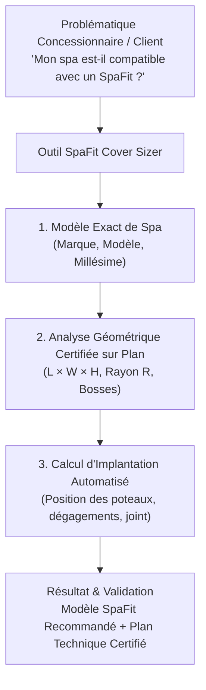

# Spécification Détaillée du Workflow Technique & Pipeline d'Ingénierie
**Système SpaFit Cover Sizer &bull; Acquisition CAO, Assainissement Anti-Corruption, Normalisation Données & Contrôle Qualité**

---

## 1. Objectif Fondamental du Projet (SpaFit Cover Sizer)

### A. Contexte Industriel SpaFit
SpaFit conçoit et fabrique des **couvercles automatisés motorisés** pour spas résidentiels et spas de nage (*modèles Oasis, Horizon, Evolution, Legend*). Contrairement aux couvertures souples traditionnelles en vinyle, les couvercles SpaFit sont des structures rigides architecturales montées sur vérins motorisés et poteaux d'élévation télescopiques :
- Ils nécessitent une étanchéité périphérique parfaite (joint d'étanchéité appliqué sur le rebord acrylique du spa).
- Ils requièrent des dégagements latéraux millimétrés pour le passage des poteaux et mécanismes.
- Ils doivent franchir sans collision les surélévations géométriques de la cuve : appuie-têtes profilés, consoles de commande tactiles rehaussées, chutes d'eau (cascades), filtres surélevés et barres de maintien.



### B. Mission du Pipeline de Données
Le pipeline de moisson technique et de scrapping a pour rôle exclusif de construire la **base de données de référence mondiale** pour le Cover Sizer :
1. **Zéro donnée synthétique ou inventée** : Interdiction formelle d'utiliser des schémas générés artificiellement ou des modèles génériques extrapolés. Si une photo, un plan PDF ou un fichier CAO n'est pas publié par le manufacturier pour un millésime donné, la base l'indique en toute transparence (`Non archivée` / `DWG non publié`).
2. **Vérification sur plans d'ingénierie (Blueprints)** : Lecture et certification des cotes géométriques (`Longueur × Largeur × Hauteur × Rayon de coin`) directement sur les plans d'implantation CAO et guides de pré-livraison officiels des manufacturiers de 2002 à 2026.
3. **Disponibilité des fichiers techniques natifs** : Centraliser les fichiers AutoCAD (`.dwg`, `.dxf`), objets BIM (`.rfa`), plans d'ingénierie constructeur recadrés (250–300 DPI) et photographies réelles d'époque (portails actuels + archives Wayback Machine par génération).
4. **Traçabilité absolue des sources** : Chaque fichier (photo dessus, meuble, plan, DWG, DXF, BIM) conserve son hyperlien source direct vers le serveur ou l'archive officielle du manufacturier.

---

## 2. Garde-Fous Anti-Corruption & Audit Forensique du Code

Suite à l'audit complet du code et des données existantes, un protocole strict d'assainissement (`sanitize_and_rebuild_dataset.py`) a été mis en place pour éliminer toute donnée fausse ou corrompue :

```mermaid
flowchart LR
    subgraph Quarantaine ["1. Scripts Mis en Quarantaine (_archive_legacy/)"]
        Q1["❌ asset_generator.py<br/>(Dessins synthétiques Pillow)"]
        Q2["❌ populate_user_brands.py<br/>(Modèles inventés Elite 800 / Relax 700)"]
        Q3["❌ enrich_media.py<br/>(Copies croisées erronées entre modèles)"]
        Q4["❌ enrich_with_official_docs...py<br/>(Pages de couverture de manuels au lieu des plans)"]
    end

    subgraph PipelinePropre ["2. Pipeline Certifié Actif"]
        P1["✅ builders_watkins.py<br/>(Cotes exactes lues sur 399 blueprints 2002-2026)"]
        P2["✅ sanitize_and_rebuild_dataset.py<br/>(Purge synthétique, déduplication MD5, auto-crop PDF)"]
        P3["✅ sync_master_index_fast.py<br/>(Indexation déterministe depuis les dossiers réels)"]
        P4["✅ build_universal_audit_gallery.py<br/>(Galerie hiérarchique Marque ➔ Modèle ➔ Année)"]
    end

    Quarantaine -.->|"Bannis du pipeline"| PipelinePropre
```



### Règles de Validation Automatisée :
1. **Purge des schémas synthétiques** : Suppression intégrale des fichiers `footprint.png`, `top_view.png` et `side_view.png` générés artificiellement par `asset_generator.py` (plus de 14 300 fichiers synthétiques purgés).
2. **Purge des modèles génériques inventés** : Suppression des 45 dossiers de marques secondaires qui ne contenaient que 4 modèles fictifs (`Elite 800`, `Relax 700`, `Swim Pro 16`, `Swim Sport 14`).
3. **Déduplication photographique par empreinte MD5** :
   - Suppression de toutes les copies croisées créées par l'ancien script `enrich_media.py` (ex: photo carrée `A6` copiée dans le spa rond `X6R` chez Bullfrog, ou photo unique copiée sur 24 modèles).
   - Affectation des photos **par génération historique réelle** (ex: chez Hot Spring, distinction entre la génération Highlife 2014–2022, la génération Highlife 2023–2026, les archives Wayback Machine 2010–2019 pour `Glow` et `Bolt`, et les séries `Freeflow` / `Cold Plunge Vigor`).
4. **Extraction des vraies pages de plans CAO & Recadrage automatique (`autocrop_blueprint_image`)** :
   - Remplacement des fausses captures de couverture (ex: photo de famille Page 1 du manuel Bullfrog 2018 ou table électrique 120V/240V Page 17 chez American Whirlpool / MAAX) par les **vraies planches de plans d'implantation CAO** (ex: les 17 planches techniques de `2024_Spa-layouts-electric-installation.pdf` chez Bullfrog, Page 52 de spécifications chez Jacuzzi et Sundance, et les 385 plans vectoriels chez Hot Spring).
   - Recadrage automatique des marges blanches et rotation orthographique à l'endroit des plans anciens (2002–2006) pour une lisibilité immédiate.

---

## 3. Inventaire des Manufacturiers Établis

Le catalogue de référence (`brands_catalog.py`) répertorie **77 manufacturiers**, répartis en deux groupes distincts après assainissement :
- **32 Manufacturiers Historiques Réels (6 346 fiches certifiées sur disque)** : Marques disposant de vrais modèles constructeur documentés année par année.
- **Dont 6 Manufacturiers Majeurs avec Médias, Plans CAO & Photos Authentiques Vérifiés (2 298 fiches)** indexés dans la Galerie Visuelle d'Audit :
  1. **Hot Spring Spas (Watkins Wellness)** : **385 fiches (2002–2026)** — 35 modèles uniques, **385 plans d'ingénierie PDF 300 DPI recadrés (100%)**, **299 fichiers CAO `.dwg` natifs**, photos réelles par génération + Wayback Machine.
  2. **Jacuzzi** : **482 fiches (2010–2026)** — Photographies réelles vue de dessus et profil + planche officielle des spécifications Pre-Delivery 2026.
  3. **MAAX Spas** : **412 fiches (2010–2026)** — Photographies réelles vue de dessus par modèle.
  4. **Sundance Spas** : **399 fiches (2010–2026)** — Photographies réelles vue de dessus + planche officielle des spécifications Pre-Delivery 2026.
  5. **Bullfrog Spas** : **340 fiches (2010–2026)** — **17 plans d'implantation CAO officiels (`M9..M6`, `A9L..A5L`, `R8L..R5L`, `X8L..X5L`, `X6R`, `STIL7`, `STIL5`, `S150..S200`)** + photographies réelles non-dupliquées.
  6. **American Whirlpool** : **279 fiches (2010–2026)** — Photographies réelles vue de dessus par modèle.
- **26 Autres Manufacturiers Historiques Réels (4 048 fiches de cotes techniques)** : Master Spas, Hydropool, Caldera Spas, Artesian Spas, Dimension One, Marquis Spas, Cal Spas, Coast Spas, Vita Spa, Beachcomber, Arctic Spas, Wellis, PDC Spas, Nordic Hot Tubs, Passion Spa, Trévi Spas, Vortex, Catalina, ThermoSpas, Endless Pools, Dream Maker, Viking Spas, Saratoga Spas, Four Winds Spas, Dynasty Spas, Strong Spas.
- **45 Marques Secondaires (Tier 4)** : Listées dans `brands_catalog.py` pour moisson future, purgées de toute donnée fictive.

---

## 4. Table de Référence des Cotes Certifiées sur Blueprints (Hot Spring 2002–2026)

Toutes les dimensions des **35 modèles Hot Spring Spas (2002–2026)** ont été lues et vérifiées directement sur les cartouches des plans d'ingénierie officiels Watkins :

| Modèle | Collection | Millésimes | Dimensions Pouces (`L × W × H`) | Dimensions Pieds | Dimensions Métriques (`cm` / `mm`) | Rayon (`R`) |
| :--- | :--- | :--- | :--- | :--- | :--- | :--- |
| **Accolade** | Highlife | 2005–2006 | `87.0" × 78.0" × 36.0"` | `7'3" × 6'6" × 3'0"` | `221.0 × 198.1 × 91.4 cm` (`2210 × 1981 × 914 mm`) | `8.0"` |
| **Aptos** | Freeflow | 2026 | `78.0" × 78.0" × 34.0"` | `6'6" × 6'6" × 2'10"` | `198.1 × 198.1 × 86.4 cm` (`1981 × 1981 × 864 mm`) | `39.0"` (Rond) |
| **Aria** | Highlife | 2006–2026 | `87.0" × 87.0" × 36.0"` | `7'3" × 7'3" × 3'0"` | `221.0 × 221.0 × 91.4 cm` (`2210 × 2210 × 914 mm`) | `8.0"` |
| **Azure** | Freeflow | 2026 | `79.0" × 67.0" × 33.0"` | `6'7" × 5'7" × 2'9"` | `200.7 × 170.2 × 83.8 cm` (`2007 × 1702 × 838 mm`) | `6.0"` |
| **Beam** | Limelight | 2018–2026 | `80.0" × 80.0" × 33.0"` | `6'8" × 6'8" × 2'9"` | `203.2 × 203.2 × 83.8 cm` (`2032 × 2032 × 838 mm`) | `7.0"` |
| **Bolt** | Limelight | 2012–2019 | `80.0" × 80.0" × 33.0"` | `6'8" × 6'8" × 2'9"` | `203.2 × 203.2 × 83.8 cm` (`2032 × 2032 × 838 mm`) | `7.0"` |
| **Envoy (Gen 1)** | Highlife | 2004–2013 | `93.0" × 89.0" × 36.0"` | `7'9" × 7'5" × 3'0"` | `236.2 × 226.1 × 91.4 cm` (`2362 × 2261 × 914 mm`) | `8.0"` |
| **Envoy (Gen 2)** | Highlife | 2014–2022 | `93.0" × 91.0" × 38.0"` | `7'9" × 7'7" × 3'2"` | `236.2 × 231.1 × 96.5 cm` (`2362 × 2311 × 965 mm`) | `8.0"` |
| **Envoy (Gen 3)** | Highlife | 2023–2026 | `100.0" × 91.0" × 38.0"` | `8'4" × 7'7" × 3'2"` | `254.0 × 231.1 × 96.5 cm` (`2540 × 2311 × 965 mm`) | `8.0"` |
| **Excursion** | Freeflow | 2026 | `78.0" × 78.0" × 34.0"` | `6'6" × 6'6" × 2'10"` | `198.1 × 198.1 × 86.4 cm` (`1981 × 1981 × 864 mm`) | `6.0"` |
| **Flair** | Limelight | 2010–2026 | `84.0" × 84.0" × 36.0"` | `7'0" × 7'0" × 3'0"` | `213.4 × 213.4 × 91.4 cm` (`2134 × 2134 × 914 mm`) | `7.0"` |
| **Flash** | Limelight | 2018–2026 | `84.0" × 84.0" × 36.0"` | `7'0" × 7'0" × 3'0"` | `213.4 × 213.4 × 91.4 cm` (`2134 × 2134 × 914 mm`) | `7.0"` |
| **Gleam** | Limelight | 2013–2017 | `110.0" × 91.0" × 38.0"` | `9'2" × 7'7" × 3'2"` | `279.4 × 231.1 × 96.5 cm` (`2794 × 2311 × 965 mm`) | `8.0"` |
| **Glow** | Limelight | 2010–2018 | `84.0" × 76.0" × 33.0"` | `7'0" × 6'4" × 2'9"` | `213.4 × 193.0 × 83.8 cm` (`2134 × 1930 × 838 mm`) | `7.0"` |
| **Grandee** | Highlife | 2002–2026 | `100.0" × 91.0" × 38.0"` | `8'4" × 7'7" × 3'2"` | `254.0 × 231.1 × 96.5 cm` (`2540 × 2311 × 965 mm`) | `8.0"` |
| **Highlife (ILE)** | Highlife | 2003 | `93.0" × 80.0" × 36.0"` | `7'9" × 6'8" × 3'0"` | `236.2 × 203.2 × 91.4 cm` (`2362 × 2032 × 914 mm`) | `8.0"` |
| **Jetsetter (Gen 1)** | Highlife | 2002–2012 | `82.0" × 62.0" × 29.0"` | `6'10" × 5'2" × 2'5"` | `208.3 × 157.5 × 73.7 cm` (`2083 × 1575 × 737 mm`) | `8.0"` |
| **Jetsetter (Gen 2)** | Highlife | 2013–2022 | `84.0" × 65.0" × 29.0"` | `7'0" × 5'5" × 2'5"` | `213.4 × 165.1 × 73.7 cm` (`2134 × 1651 × 737 mm`) | `8.0"` |
| **Jetsetter (Gen 3)** | Highlife | 2023–2026 | `84.0" × 68.0" × 33.0"` | `7'0" × 5'8" × 2'9"` | `213.4 × 172.7 × 83.8 cm` (`2134 × 1727 × 838 mm`) | `8.0"` |
| **Jetsetter LX (G1)** | Highlife | 2014–2022 | `84.0" × 65.0" × 33.0"` | `7'0" × 5'5" × 2'9"` | `213.4 × 165.1 × 83.8 cm` (`2134 × 1651 × 838 mm`) | `8.0"` |
| **Jetsetter LX (G2)** | Highlife | 2023–2026 | `84.0" × 68.0" × 33.0"` | `7'0" × 5'8" × 2'9"` | `213.4 × 172.7 × 83.8 cm` (`2134 × 1727 × 838 mm`) | `8.0"` |
| **Landmark** | Highlife | 2002–2003 | `100.0" × 91.0" × 38.0"` | `8'4" × 7'7" × 3'2"` | `254.0 × 231.1 × 96.5 cm` (`2540 × 2311 × 965 mm`) | `8.0"` |
| **Mini** | Freeflow | 2026 | `72.0" × 53.0" × 29.0"` | `6'0" × 4'5" × 2'5"` | `182.9 × 134.6 × 73.7 cm` (`1829 × 1346 × 737 mm`) | `6.0"` |
| **Monterey** | Freeflow | 2026 | `78.0" × 78.0" × 34.0"` | `6'6" × 6'6" × 2'10"` | `198.1 × 198.1 × 86.4 cm` (`1981 × 1981 × 864 mm`) | `6.0"` |
| **Pace** | Hot Spot | 2020–2026 | `82.0" × 82.0" × 33.0"` | `6'10" × 6'10" × 2'9"` | `208.3 × 208.3 × 83.8 cm` (`2083 × 2083 × 838 mm`) | `6.0"` |
| **Prism** | Limelight | 2018–2026 | `110.0" × 91.0" × 38.0"` | `9'2" × 7'7" × 3'2"` | `279.4 × 231.1 × 96.5 cm` (`2794 × 2311 × 965 mm`) | `7.0"` |
| **Prodigy (Gen 1)** | Highlife | 2002–2016 | `87.0" × 74.0" × 33.0"` | `7'3" × 6'2" × 2'9"` | `221.0 × 188.0 × 83.8 cm` (`2210 × 1880 × 838 mm`) | `8.0"` |
| **Prodigy (Gen 2)** | Highlife | 2017–2026 | `84.0" × 78.0" × 33.0"` | `7'0" × 6'6" × 2'9"` | `213.4 × 198.1 × 83.8 cm` (`2134 × 1981 × 838 mm`) | `8.0"` |
| **Propel** | Hot Spot | 2018–2019 | `82.0" × 82.0" × 33.0"` | `6'10" × 6'10" × 2'9"` | `208.3 × 208.3 × 83.8 cm` (`2083 × 2083 × 838 mm`) | `6.0"` |
| **Pulse** | Limelight | 2010–2026 | `89.0" × 89.0" × 38.0"` | `7'5" × 7'5" × 3'2"` | `226.1 × 226.1 × 96.5 cm` (`2261 × 2261 × 965 mm`) | `7.0"` |
| **Relay** | Hot Spot | 2010–2026 | `84.0" × 84.0" × 36.0"` | `7'0" × 7'0" × 3'0"` | `213.4 × 213.4 × 91.4 cm` (`2134 × 2134 × 914 mm`) | `6.0"` |
| **Rhythm** | Hot Spot | 2010–2026 | `84.0" × 84.0" × 36.0"` | `7'0" × 7'0" × 3'0"` | `213.4 × 213.4 × 91.4 cm` (`2134 × 2134 × 914 mm`) | `6.0"` |
| **Sovereign** | Highlife | 2002–2026 | `93.0" × 80.0" × 33.0"` | `7'9" × 6'8" × 2'9"` | `236.2 × 203.2 × 83.8 cm` (`2362 × 2032 × 838 mm`) | `8.0"` |
| **Stride** | Hot Spot | 2018–2026 | `84.0" × 65.0" × 29.0"` | `7'0" × 5'5" × 2'5"` | `213.4 × 165.1 × 73.7 cm` (`2134 × 1651 × 737 mm`) | `6.0"` |
| **SX (Gen 1)** | Hot Spot | 2010–2019 | `72.0" × 72.0" × 33.0"` | `6'0" × 6'0" × 2'9"` | `182.9 × 182.9 × 83.8 cm` (`1829 × 1829 × 838 mm`) | `6.0"` |
| **SX (Gen 2)** | Hot Spot | 2020–2026 | `77.0" × 72.0" × 33.0"` | `6'5" × 6'0" × 2'9"` | `195.6 × 182.9 × 83.8 cm` (`1956 × 1829 × 838 mm`) | `6.0"` |
| **Tempo** | Hot Spot | 2012–2019 | `89.0" × 89.0" × 38.0"` | `7'5" × 7'5" × 3'2"` | `226.1 × 226.1 × 96.5 cm` (`2261 × 2261 × 965 mm`) | `6.0"` |
| **Triumph** | Highlife | 2018–2021 | `93.0" × 74.0" × 33.0"` | `7'9" × 6'2" × 2'9"` | `236.2 × 188.0 × 83.8 cm` (`2362 × 1880 × 838 mm`) | `8.0"` |
| **TX (Gen 1)** | Hot Spot | 2010–2019 | `68.5" × 68.5" × 29.0"` | `5'8.5" × 5'8.5" × 2'5"` | `174.0 × 174.0 × 73.7 cm` (`1740 × 1740 × 737 mm`) | `6.0"` |
| **TX (Gen 2)** | Hot Spot | 2020–2026 | `72.0" × 72.0" × 29.0"` | `6'0" × 6'0" × 2'5"` | `182.9 × 182.9 × 73.7 cm` (`1829 × 1829 × 737 mm`) | `6.0"` |
| **Vanguard** | Highlife | 2002–2026 | `87.0" × 87.0" × 36.0"` | `7'3" × 7'3" × 3'0"` | `221.0 × 221.0 × 91.4 cm` (`2210 × 2210 × 914 mm`) | `8.0"` |
| **Vigor** | Cold Plunge | 2025–2026 | `88.0" × 42.0" × 29.0"` | `7'4" × 3'6" × 2'5"` | `223.5 × 106.7 × 73.7 cm` (`2235 × 1067 × 737 mm`) | `6.0"` |
| **Vista** | Highlife | 2004–2013 | `100.0" × 91.0" × 38.0"` | `8'4" × 7'7" × 3'2"` | `254.0 × 231.1 × 96.5 cm` (`2540 × 2311 × 965 mm`) | `8.0"` |

---

## 5. Protocole de Redémarrage de Zéro (Disaster Recovery & Bootstrap)

Ce protocole permet de réinstaller, d'assainir et de régénérer l'intégralité du projet de manière déterministe et 100% reproductible.

### A. Installation de l'Environnement Virtuel & Dépendances
Dans `D:\SPAFIT\Cover Sizer\scrapping python\` :

```powershell
python -m venv .venv
.\.venv\Scripts\Activate.ps1
python -m pip install --upgrade pip
pip install requests beautifulsoup4 pymupdf pypdf pillow pyyaml tabulate pydantic
```

### B. Ordre d'Exécution Séquentiel Certifié

```powershell
# -------------------------------------------------------------
# ÉTAPE 1 : Moisson des archives CAO officielles et extraction DWG
# Télécharge les archives ZIP Watkins S3 (2002-2026) et extrait les DWG/PDF
# -------------------------------------------------------------
& ".\scrapping python\.venv\Scripts\python.exe" -u "scrapping python\harvest_all_cad_zips.py"

# -------------------------------------------------------------
# ÉTAPE 2 : Moisson des photos historiques Wayback Machine (Glow, Bolt)
# -------------------------------------------------------------
& ".\scrapping python\.venv\Scripts\python.exe" -u "scrapping python\apply_wayback_historical_photos.py"

# -------------------------------------------------------------
# ÉTAPE 3 : Assainissement Maître, Recadrage Blueprints & Alignement Cotes
# - Purge des marques factices et des schémas synthétiques
# - Application des cotes certifiées sur blueprints (2002-2026)
# - Extraction et auto-crop des plans CAO (Hot Spring, Bullfrog, Jacuzzi, Sundance)
# - Affectation des vraies photos par génération avec URLs sources
# -------------------------------------------------------------
& ".\scrapping python\.venv\Scripts\python.exe" -u "scrapping python\sanitize_and_rebuild_dataset.py"

# -------------------------------------------------------------
# ÉTAPE 4 : Reconstruction déterministe de spa_master_index.json & .csv
# -------------------------------------------------------------
& ".\scrapping python\.venv\Scripts\python.exe" -u "scrapping python\sync_master_index_fast.py"

# -------------------------------------------------------------
# ÉTAPE 5 : Génération de la Galerie d'Audit Hiérarchique HTML5
# Groupement automatique : Marque ➔ Modèle ➔ Année + 4 unités + Liens sources
# -------------------------------------------------------------
& ".\scrapping python\.venv\Scripts\python.exe" -u "scrapping python\build_universal_audit_gallery.py"
```
