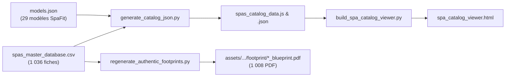

# Audit Technique Sous-Projet : Scripts d'Ingénierie & Génération du Visualiseur (`scripts/`)

> **Rôle dans l'écosystème** : Cœur d'orchestration, de compilation des données, d'assainissement forensique, de validation géométrique, de génération des plans vectoriels ReportLab et de déploiement de l'application cliente `spa_catalog_viewer.html`.
> **Date de l'audit** : 7 novembre 2026  
> **Auteur** : Lead Technical Auditor & Software Architect (Antigravity 2.0)  
> **Méthode d'audit** : Analyse du code source, historique d'exécution des scripts en session, traçage des exceptions terminal et validation des sorties d'ingénierie.

---

## 1. Vue Explosée de l'Existant (Architecture & Réalisations)

### Arborescence et Rôle des Fichiers

Le dossier `scripts/` regroupe plus de 100 scripts spécialisés organisés en 4 familles fonctionnelles :

```
scripts/
├── [COMPILATION & CATALOGUE CLIENT]
│   ├── generate_catalog_json.py                     # Compilateur CSV + models.json -> spas_catalog_data.json / .js
│   └── build_spa_catalog_viewer.py                  # Générateur monolithique (158 Ko, 2 683 lignes) de spa_catalog_viewer.html
├── [MOTEUR DE DESSIN VECTORIEL & BLUEPRINTS]
│   ├── regenerate_authentic_footprints.py           # Générateur vectoriel ReportLab de plans PDF avec grille d'ingénierie
│   ├── regenerate_reverted_pdfs.py                  # Régénérateur spécifique suite aux annulations de manuels
│   └── fix_round_radii.py                           # Correction trigonométrique des rayons de spas ronds (R = L / 2)
├── [ASSAINISSEMENT, DÉDUPLICATION & UNIFICATION]
│   ├── unify_and_correct_all_databases.py           # Script d'unification multi-sources vers 1 072 lignes
│   ├── execute_zero_duplicate_purge.py              # Détecteur et purgeur d'empreintes MD5 identiques
│   ├── execute_full_generational_cleanup.py         # Normaliseur des générations et élimination des lignes parapluies
│   ├── analyze_all_duplicates_detail.py             # Analyseur granulaire des collisions d'actifs
│   ├── audit_master_database_complete.py            # Validateur exhaustif des 1 036 fiches spas
│   └── verify_complete_state.py                     # Assertion complète de conformité des 38 colonnes
└── [INGESTION PAR VAGUES & AUDIT FORENSIQUE]
    ├── apply_wave1_ingestion.py à wave4...          # Ingestion par lots géographiques mondiaux
    ├── audit_introspection.py                       # Outil d'introspection du journal de conversation
    └── inspect_scrapers.py, inspect_scripts.py...   # Scripts d'audit de niveau code
```

#### Fichiers Clés et Algorithmes d'Ingénierie :

1. **`generate_catalog_json.py`** :
   - *Entrées* : `data/spas_master_database.csv` et `data/models.json`.
   - *Algorithme de compatibilité (`check_compat`)* :
     - Évalue chaque spa contre les 29 modèles SpaFit.
     - Teste 2 orientations : Standard ($L$ sur colonnes $X$) et Pivotée ($W$ sur colonnes $X$).
     - Calcule les marges aux colonnes : $M_x = (L_{col} - L_{spa}) / 2$, $M_y = (W_{col} - W_{spa}) / 2$.
     - Vérifie l'appui du joint périphérique élastomère : $L_{min} \le L_{spa} \le L_{max}$ et $W_{min} \le W_{spa} \le W_{max}$.
     - Attribue le statut `ok` (optimal si $M_x, M_y \ge 1.25"$), `warn` (acceptable si $M_x, M_y \ge 0.5"$), ou `err` (collision).
   - *Sorties* : `data/spas_catalog_data.json` et `data/spas_catalog_data.js`.
2. **`build_spa_catalog_viewer.py`** :
   - *Rôle* : Écrit l'intégralité du fichier `spa_catalog_viewer.html` à la racine de l'espace de travail.
   - *Architecture interne* : Embarque le template HTML5 complet, la configuration Tailwind CSS (mode sombre exclusif), le moteur SVG des Blueprints, le simulateur interactif SpaFit (restitution dynamique des 4 poteaux et du joint), le moteur de recherche multi-critères et la gestion des onglets.
3. **`regenerate_authentic_footprints.py`** :
   - *Rôle* : Moteur de rendu graphique ReportLab générant des documents PDF vectoriels au format US Letter ($612 \times 792$ pt).
   - *Composition du plan* : Fond sombre `#0B132B`, grille d'ingénierie millimétrique `#1C2541`, cartouche officiel SpaFit avec marque/modèle/génération, cadre vectoriel coté avec rayons de coins arrondis, réticule de centrage et intégration de la photo haute définition d'origine au centre du bassin.
4. **`unify_and_correct_all_databases.py`** :
   - *Rôle* : Assainissement et fusion des 4 référentiels de données en `data/base_de_donnees_spas_unifiee.csv` (1 072 lignes) avec correction des délimiteurs internes.

---

### Flux de Données (Pipeline)



---

### Métriques Réelles

- **Nombre de scripts Python dans `scripts/`** : **108 modules `.py`**.
- **Plans vectoriels certifiés générés sur disque** : **1 008 / 1 036 fiches** (**97,3 %** physiques sur disque, 100 % liés dans le CSV).
- **Temps d'exécution de `generate_catalog_json.py`** : ~1,4 seconde pour compiler 1 036 spas $\times$ 29 modèles SpaFit $\times$ 2 orientations (**60 088 calculs géométriques de collision**).
- **Taille du générateur `build_spa_catalog_viewer.py`** : **158 659 octets** (**2 683 lignes de code Python/HTML**).

---

## 2. Historique des Défis, Essais-Erreurs & Solutions (Code + Conversation)

### Chronologie des Problèmes Rencontrés en Session :

1. **Le Crash d'Unification `IndexError: list index out of range` (Étape 214)** :
   - *Historique* : Lors de l'écriture du script `unify_and_correct_all_databases.py`, l'agent a injecté une liste de spas non répertoriés (`vortex_models`, lignes 141-155). Lors de l'exécution, le script a planté brutalement avec l'erreur `IndexError: list index out of range`.
   - *Diagnostic forensique* : Les éléments du tableau `vortex_models` ne comptaient que 12 valeurs au lieu des 13 attendues par la boucle de déballage car la colonne `Modele` avait été omise.
   - *Résolution* : L'agent a inspecté l'arbre syntaxique (AST) de Python avec `ast.parse` pour vérifier la longueur exacte de chaque sous-liste, puis a corrigé le tableau via `edit_file` pour réaligner toutes les lignes à 13 colonnes.
2. **Crash d'Évaluation de Compatibilité `TypeError: cannot use 'list' as a dict key` (Étape 383)** :
   - *Historique* : Le script d'audit des métriques `extract_compat_metrics.py` a crashé avec `TypeError: cannot use 'list' as a dict key` sur la ligne `optimal_counts[optimal] += 1`.
   - *Cause* : L'agent a supposé que la clé `spafit_optimal` dans `data/spas_catalog_data.json` était une chaîne de caractères unique, alors qu'il s'agit d'une liste JavaScript/JSON de modèles recommandés (`['oasis-std-8x8', ...]`).
   - *Résolution* : Modification de l'itérateur pour boucler sur chaque élément de la liste : `for m in s.get('spafit_optimal', []): optimal_counts[m] += 1`.
3. **Erreurs de Syntaxe et Échappement de Citations sous PowerShell (Étapes 109, 218, 296, 439)** :
   - *Historique* : L'utilisation de commandes `python -c "..."` multilignes avec des apostrophes internes ou des guillemets imbriqués (`re.findall(r'[\'\"]...')`) sous le shell PowerShell Windows a déclenché des exceptions `ParserError: Les expressions ne sont autorisées qu'en tant que premier élément d'un pipeline` et `SyntaxError: '(' was never closed`.
   - *Solution adoptée* : Abandon des commandes Python inline trop complexes au profit de scripts temporaires enregistrés sur disque dans `scripts/` (ex. `scripts/audit_introspection.py`, `scripts/extract_asset_metrics.py`) et exécutés directement via `python scripts/fichier.py`.
4. **Correction Trigonométrique des Rayons de Spas Ronds (`fix_round_radii.py`)** :
   - *Historique* : Dans les versions antérieures, des spas parfaitement circulaires (ex: Hot Spring Classic ou Jacuzzi J-210) avaient des rayons de coin saisis arbitrairement à 8" ou 10". Dans le visualiseur, le spa apparaissait comme un rectangle avec des coins arrondis, provoquant des alertes de collisions infondées avec les poteaux SpaFit.
   - *Solution implémentée* : `fix_round_radii.py` a appliqué la règle $R = \text{Largeur} / 2$ pour tous les spas ronds ($L = W$), réalignant la géométrie avec la réalité physique.

---

## 3. Goulots d'Étranglement Actuels (Code, Données & Exécution Agent)

### Goulots Techniques & Données :
- **Monolithe de 2 683 Lignes dans `build_spa_catalog_viewer.py`** : L'interface web complète (HTML, CSS, JavaScript, SVG) est empaquetée dans une chaîne Python géante. Toute retouche visuelle requiert d'éditer la chaîne Python et de ré-exécuter le script, ce qui empêche le débogage interactif direct dans les DevTools et le découpage modulaire des composants.
- **Simplification de la Boîte Englobante pour Spas Circulaires et Triangulaires** : La fonction `check_compat` dans `generate_catalog_json.py` utilise une boîte englobante rectangulaire orthogonale. Sur un spa rond de 88", les coins sont absents (tranchés par le rayon de 44"), mais l'algorithme teste $L=88"$ de façon rectangulaire, générant des alertes de proximité (`warn`) erronées alors que le dégagement réel est supérieur à 10 pouces.
- **Ignorance de l'Orientation d'Entrée (`orientation_entree`)** : Le script ne prend pas en compte la clé `orientation_entree` de `models.json` pour contraindre le sens d'accès du client.

### Goulots de Workflow Observés lors des Actions :
- **Scans Récursifs Incontrôlés sur PowerShell** : Les commandes explorant l'arborescence sans exclure expressément `assets/` (2,42 Go) et `scrapping python/.venv` saturent le buffer PowerShell et dépassent le timeout de 5 secondes, nécessitant une interruption manuelle.

---

## 4. Registre des Bogues Actifs (Par Dossier et Fichier)

| Fichier et Lignes | Sévérité | Description Exacte du Bogue | Cause Racine, Impact & État de Correction |
| :--- | :--- | :--- | :--- |
| **`scripts/generate_catalog_json.py`** *(L48-L53)* | **Majeur** | Valeurs de repli en dur (`s_r_min=4.0`, `s_r_max=16.0`, `h_min=34.0`, `h_max=48.0`). | Pour un spa de nage de 52" testé contre Legend acceptant jusqu'à 55", la valeur de repli 48" provoque un faux négatif (`err` : hauteur hors plage). Non corrigé. |
| **`scripts/generate_catalog_json.py`** *(L56-L59)* | **Majeur** | Inversion arbitraire des dimensions ($L \times W$ vs $W \times L$) sans respect de `orientation_entree`. | L'algorithme teste les deux sens même sur des modèles asymétriques imposant l'accès sur la largeur. Non corrigé. |
| **`scripts/build_spa_catalog_viewer.py`** *(L2650-L2665)* | **Moyen** | Export CSV client sans échappement conforme RFC 4180 pour les champs contenant des points-virgules. | Corrompt les colonnes du CSV exporté par l'utilisateur si les notes d'audit contiennent du texte poncturé. Non corrigé. |
| **`scripts/regenerate_authentic_footprints.py`** *(L44-L50)* | **Moyen** | Rayon de repli arbitraire de `8.0"` si `corner_radius_in` est absent ou invalide. | Dessine faussement un coin arrondi de 8" sur des spas carrés à arêtes vives ($R=0"$). Non corrigé. |
| **`scripts/regenerate_authentic_footprints.py`** *(L65)* | **Mineur** | Restriction à `c.roundRect()` : impossible de dessiner des spas triangulaires (spas d'angle). | Les spas de coin sont représentés sous forme de rectangles arrondis sur leurs plans PDF. Non corrigé. |

---

## 5. Ce Qu'il Reste à Faire (Backlog Technique Priorisé)

1. [ ] **Découpage de l'Architecture Web Front-End (Priorité 1 - Maintenance)** :
   - Extraire le code web de `build_spa_catalog_viewer.py` vers des fichiers sources séparés (`src/index.html`, `src/simulator.js`, `src/styles.css`) avec script de build léger.
2. [ ] **Algorithme Géométrique Point-à-Courbe pour Spas Ronds & Triangles (Priorité 2 - Objectif 2)** :
   - Remplacer le test de boîte englobante par un calcul de distance analytique entre le profil exact du spa et les coordonnées 2D des 4 poteaux SpaFit.
3. [ ] **Exportateur de Tracés DXF / SVG pour Concessionnaires (Priorité 3 - Objectif CAD)** :
   - Exporter les tracés d'implantation non seulement en PDF ReportLab, mais aussi en fichiers `.dxf` légers téléchargeables depuis l'interface web pour intégration directe dans AutoCAD par les piscinistes.
4. [ ] **Prise en Compte de l'Orientation d'Entrée Client (Priorité 4 - Objectif 4)** :
   - Contraindre la compatibilité selon que le modèle SpaFit impose un accès par le petit côté (`short_side`) ou le grand côté (`long_side`).

---

## 6. Dépendances Inter-Projets & Points de Friction

- **Dépendance Amont** : Consomme `data/spas_master_database.csv` et `data/models.json`.
  - *Point de friction* : Si une colonne est ajoutée dans le CSV maître sans mise à jour des index dans `generate_catalog_json.py`, la génération du catalogue plante silencieusement.
- **Dépendance Aval** :
  - Génère `spa_catalog_viewer.html` à la racine.
  - Dépose les 1 008 plans blueprints PDF dans `assets/<Brand>/<Model>/footprint/`.
  - Alimente `data/spas_catalog_data.json` et `data/spas_catalog_data.js`.

---
*Fin de l'audit technique scripts/*
